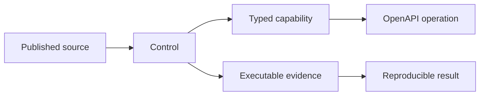

# Assurance Graph

The Assurance Graph connects each public API operation to an accountable capability, control owner, governing source and executable evidence artifact. It gives insurer, government, regulator, security and engineering reviewers one machine-readable path from a public claim to the contract and test that support it.

The graph describes Heyrafiki's verified contract. It does not claim regulatory approval, certification or partnership. Access remains separate: API discovery is public; sandbox operations use a sandbox key; institutional capabilities use a scoped Organization grant.

## What is connected



The current graph covers all public OpenAPI operations. A contract change fails CI when it introduces an operation without an accountable capability and control mapping, references missing evidence, or breaks the graph's referential integrity.

## Cross-authority boundary

| Source | What it governs | What Heyrafiki records |
| --- | --- | --- |
| Insurance Regulatory Authority | Insurance conduct, policyholder protection and Claims-management expectations | Claim, decision, communication, financial and audit evidence an accountable insurer can review |
| Ministry of Health and Digital Health Agency | Digital health certification, registries, Consent, terminology and health information exchange | Versioned adapter observations, registry identifiers, Consent decisions and conformance evidence |
| Counsellors and Psychologists Board | Registration and licensing of counsellors and psychologists | Source observation, category, licence period, freshness and the separate Platform eligibility decision |
| eCitizen and GavaConnect | Approved government access and API integration paths | Issued scope, external reference, adapter version, response evidence and failure semantics |

No external source is silently copied into Heyrafiki authority. The source response and version remain attached to the normalized observation.

## Bitemporal Claim valuation timeline

The Claim valuation fixture records two times for every event:

- `effective_at`: when the underlying Care, Claim, decision or money fact took effect;
- `recorded_at`: when Heyrafiki learned and recorded that fact.

This distinction makes an as-of review reproducible. A valuation at 31 July cannot use an adjustment first recorded on 2 August, even if the adjustment is backdated. The fixture reconciles billed amount, payer liability, patient responsibility, adjustment, remittance advice, observed settlement and outstanding liability using integer minor units.

The timeline supports development analysis for reported Claims and reproducible outstanding observations. Portfolio reserving, IBNR methods, capital, solvency and actuarial opinions remain with the insurer and its appointed actuarial authority.

## Run the evidence

```bash
npm ci
npm test
```

The machine-readable artifacts are:

- `assurance/assurance-graph.json`
- `assurance/assurance-graph.schema.json`
- `fixtures/claim-valuation-timeline.json`
- `assurance/claim-valuation-timeline.schema.json`

## Primary public sources

- [IRA Claims Management Guidelines](https://www.ira.go.ke/images/docs/Guidelines1_on_Claims_Management.pdf)
- [IRA Market Conduct Guidelines](https://ira.go.ke/assets/file/Guidelines_on_Market_Conduct_for_Insurers.pdf)
- [DHA certification framework](https://certification.dha.go.ke/framework)
- [DHA Health Information Exchange](https://hie-docs.dha.go.ke/introduction)
- [Counsellors and Psychologists Board registration services](https://cpb.health.go.ke/registration-services)
- [GavaConnect](https://www.developer.go.ke/)
